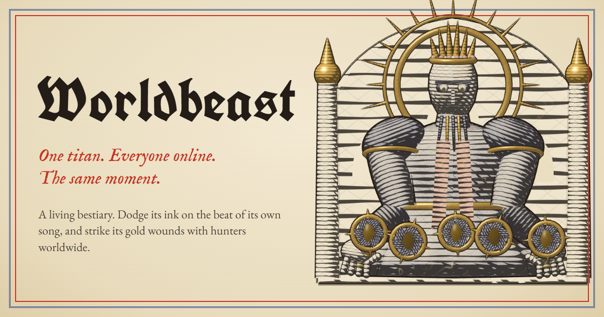

<p align="center"></p>

# WORLDBEAST

**One titan. Everyone online. The same moment.**

A colossal titan, engraved live like a plate from a medieval bestiary, is awake right now, and everyone playing fights it in the same moment. Weave your tiny light through attacks that land on the beat of its own generated song, graze them to charge a Surge, and strike its gold wounds with hunters worldwide. When it falls, the final blow is written into the Hall of Titans and a new titan, with a new body, song and name, wakes.

Play: **https://worldbeast-23b97912.base44.app** · free, no login, no download · keyboard, mouse, touch or gamepad · sound on.

Built for the Base44 × Nitro Web Game Contest, 2026.

## What makes it work

| | |
|---|---|
| **One fight, every browser** | A titan is born from one number (its seed). Its anatomy, colours, name, tempo, key and the plan of every attack follow from that seed. Every drop of ink has a closed-form path: its position is a pure function of the seed and the seconds since the titan woke. So every browser that knows the seed and the server clock draws the identical fight, and nothing about the attacks is ever sent over the network. |
| **A Base44 actor keeps the world** | One `world` actor session holds the authoritative clock, the titan's wounds, the hunters' positions (10 Hz), downed sparks and revives, and the titan's life: it wakes, falls (final blow recorded) or escapes after 8 h, and the next one wakes 20 s later. Anonymous players connect over WebSockets; no account is needed. |
| **Blows are checked, not trusted** | The actor runs the same fight code as the browser (`src/core` is synced into the actor), so it knows on which beats each wound is open. It rejects blows on closed wounds, off-beat blows, impossible single hits, and anything above a per-light damage budget (a 2 s burst cap and a 12 s sustained cap). |
| **The database is the memory** | `Titan`, `Hunter`, `Run` and `Echo` are Base44 entities written only by the actor (create/update blocked for browsers, reads public). When a titan ends, Base44's built-in LLM writes its epitaph for the Hall (at most three a day, with a template otherwise). |
| **Echoes** | Your path is kept when your light goes out. Because the titan's song (the Canticle, 8 phrases of 16 bars) repeats, an echo flies again exactly where it flew before, dodging the same attacks on the same beats. |
| **Drawn as an engraving** | three.js shaders turn light into families of engraved lines that follow each part's surface, with a hand-coloured wash beneath, gold leaf, and gold kintsugi seams that open as the world wounds the titan. On first load the titan is cut onto the page line by line. |
| **Sung, not looped** | A Web Audio engine composes each titan's score from its seed (drone, choir, frame drums, psaltery, bells), voices every attack a beat before it lands so you can dodge by ear, and keeps every note within a couple of milliseconds of the shared clock. |

## Authorship and rights

WORLDBEAST is an original game by **Rohan Borade**. Every line of code, every titan, the key art and logo, and all of the music and sound effects (synthesised live in the browser, no samples) were made for this contest between 9 and 10 November 2026. The commit history in this repository is the full record of that work, from the first commit on 9 November.

It was built on Base44 from the start: the app was created on Base44 with the official Base44 CLI (`base44 create --template backend-and-client`), its world runs as a Base44 realtime actor, its records are Base44 entities, its epitaphs come from Base44's AI integration, and it is hosted and deployed by Base44 (`base44 deploy`). This repository is linked to the Base44 app, so the source lives with it. See [LICENSE](LICENSE): all rights reserved; third-party libraries and fonts are credited there under their own licences.

## Playing

- Move with **WASD** / arrows, or drag anywhere (touch). **Space** (or double-tap / the dash button) dashes through an attack.
- Your light strikes open **gold wounds** by itself; nearer the titan strikes harder.
- **Graze** attacks to fill Resonance, then **Surge**. Three hits put your light out; a passing hunter can rekindle it within 8 s.
- **Hounds**, small volleys aimed at you alone, keep a still hunter honest and grow fiercer the longer you last.
- The left leaf shows the titan's bestiary entry, its wounds, the hunters, the chronicle and **the Canticle**: its song written as plainchant, every attack a neume, every open wound a gold bar.

## Code

```
src/core      the rules: seeded titans, closed-form attacks, the hunter's run, a look-ahead bot (shared with the actor)
src/game      three.js renderer (page, ink, engraved titans, hunters, fx), input, the Web Audio engine
src/net       the World client: clock sync, interpolation, batching, echoes, offline fallback
src/ui        the codex interface: cover, bestiary leaf, Canticle, HUD, seals, Hall of Titans, How it works
base44/       entities (Titan, Hunter, Run, Echo) and the `world` actor
scripts/      sync-core (copies src/core into the actor) and live checks
```

Run locally: `npm install`, then `npm run dev`. Tests: `npx vitest run` (rules, fairness, actor and client). Deploy: `npm run deploy` (Base44 CLI).
